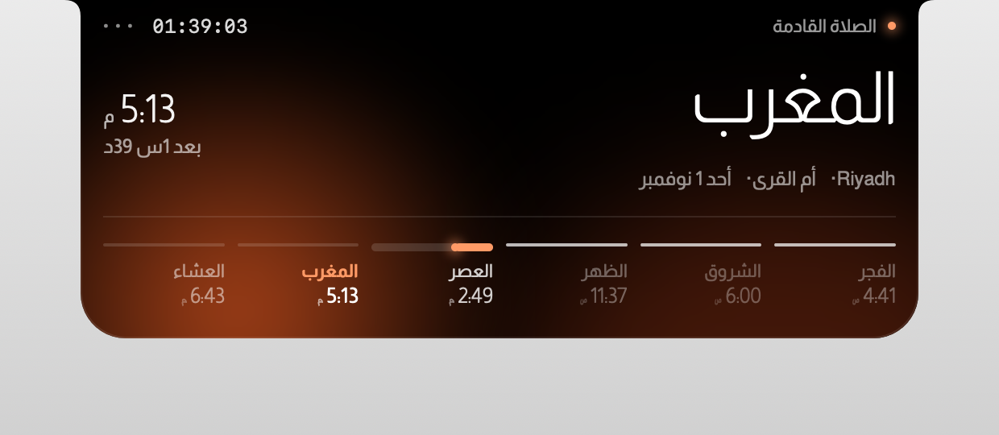
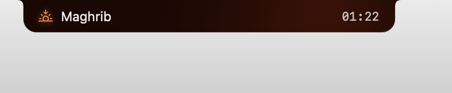
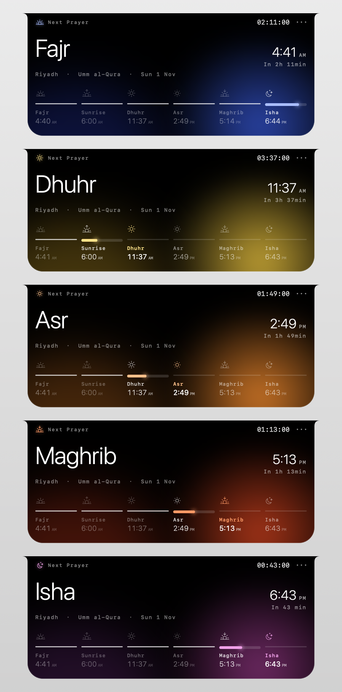
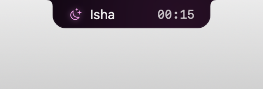

# Prayer

مواقيت الصلاة على نوتش الماك بوك. الصلاة القادمة والعدّاد بجانب النوتش، ولوحة بتفتح عند تمرير الماوس فيها تايم لاين اليوم كله. والأجهزة اللي من غير نوتش (ماك بوك إير، آي ماك، شاشة خارجية) بتاخد نفس الجزيرة بنفس الديزاين في أعلى الشاشة. المواقيت بتتحسب محليًا بمحرك Adhan، والطريقة بتتحدد تلقائيًا حسب الدولة (أم القرى للسعودية، الهيئة المصرية لمصر...) وبتوقيت المدينة المختارة.

A macOS app that turns the MacBook notch into a prayer-times island: the next prayer and a live countdown sit beside the notch, and hovering opens a panel with the day's timeline. Macs without a notch (MacBook Air, iMac, external displays) get the same island as a virtual notch at the top of the main display. Times are computed on-device with the [Adhan](https://github.com/batoulapps/adhan-swift) engine, the calculation method is picked automatically per country (Umm al-Qura for Saudi Arabia, Egyptian General Authority for Egypt, ...), and everything is shown in the chosen city's time zone.

<p align="center"></p>
<p align="center"></p>
<p align="center"></p>
<p align="center"></p>

## Install on any Mac

```bash
curl -fsSL https://raw.githubusercontent.com/elnabalawy23-netizen/prayer-for-mac/main/install.sh | bash
```

The script downloads the latest release, puts it in /Applications, clears the quarantine flag, and launches the app. Hover the notch (or the island on a Mac without one) to open the panel; click it to pin it open; `···` opens Settings.

**Manual download instead:** grab `Prayer-<version>.zip` from the [latest release](https://github.com/elnabalawy23-netizen/prayer-for-mac/releases/latest), unzip, drag `Prayer.app` into Applications and open it. macOS blocks the first launch because the app is signed with a local certificate rather than an Apple Developer ID: open System Settings → Privacy & Security, scroll down and click **Open Anyway** (or run `xattr -dr com.apple.quarantine /Applications/Prayer.app`), then open it again. Once per Mac.

First launch asks for Location access so it can pick your city; you can instead choose any city by name in Settings. Updates installed with the same script or by the app itself keep the permission, because every release is signed with the same certificate.

## Features

- Notch strip: the next prayer with its icon on the left, `HH:MM` countdown on the right; each wing sized to its text and centered, nothing else outside the notch
- Hover panel: big prayer name, time, "in 1h 39min", city · method · date, and a six-segment timeline (Fajr → Sunrise → Dhuhr → Asr → Maghrib → Isha → Fajr) with an icon per prayer and a live fill
- A different glow for every prayer: indigo before Fajr, gold before Dhuhr, orange before Asr, burnt sienna before Maghrib, plum before Isha
- Location: automatic (CoreLocation) or any city by name (Apple Maps search), with the city's own time zone and its Arabic/English name
- Calculation method and Asr madhab chosen per country, both overridable; 12/24-hour; English UI, with Arabic (set in Almarai) as an option
- Macs without a notch get the same design as a virtual island hanging from the top edge of the main display (28 pt, a touch taller than the menu bar); it steps aside on full-screen Spaces. The menu-bar icon is optional on every Mac
- Launch at login
- Self-updating: checks GitHub daily (or weekly / never), installs the new release and relaunches; "Check now" in Settings → Updates

## Requirements

- macOS 14 Sonoma or newer (built and tested on macOS 26.2 Tahoe), any Mac: the island sits in the notch when there is one, at the top of the screen otherwise
- To build: Swift 6 toolchain from Xcode **or** the Command Line Tools (`xcode-select --install`)

## Build, sign, release

```bash
make cert       # once per build machine: creates the local signing certificate (asks for your password once)
make app        # builds build/Prayer.app signed with that certificate
make run        # build + launch from build/
make install    # build + copy to /Applications + launch
make release    # build + zip + publish a GitHub release for the version in Packaging/Info.plist
make render     # renders the notch UI (Arabic + English) and the virtual island to build/render/ for design review
                # PRAYER_RENDER_AT="02:30,08:00,13:00,16:00,18:00" previews every prayer's glow in one image
make dev        # swift run, no bundle, for quick iteration
```

To ship a new version: bump `CFBundleShortVersionString` in `Packaging/Info.plist`, commit, run `make release`. Every installed copy picks it up on its next check (daily by default), or immediately with **Check now**. Before swapping itself the app verifies that the downloaded bundle satisfies its own designated requirement, i.e. it is signed with the same certificate; anything else is refused.

### Why the certificate matters

macOS ties the Location grant to the app's code signature. An ad-hoc signature changes with every build, so every update would look like a brand-new app and ask again. `make cert` creates a self-signed code-signing certificate in your login keychain (backed up in `~/.prayer-signing/`). Every build signed with it has the same designated requirement, so macOS keeps trusting updates. It is not an Apple Developer ID, which is why the installer clears the quarantine flag instead of relying on Gatekeeper. To sign from a second Mac, copy `~/.prayer-signing/` there and run `make cert`; it imports the saved certificate instead of creating a new one.

## Testing the updater

```bash
PRAYER_UPDATE_CHECK_DELAY=2 /Applications/Prayer.app/Contents/MacOS/Prayer   # checks GitHub 2 s after launch, ignoring the daily gate
```

Publish a higher version first; the installed copy downloads it, verifies the signature, swaps itself and relaunches. Only on a throwaway copy: `PRAYER_FAKE_VERSION=0.9.0` makes the app believe it is older than the latest release.

`PRAYER_FORCE_ISLAND=1` makes a notch Mac use the virtual island, to try the no-notch layout.

## Accuracy

Times come from Adhan's astronomical algorithm with the official parameters of each authority, rounded to the minute, in the selected city's time zone. Checked against the Aladhan API for Riyadh (Umm al-Qura) and Cairo (Egyptian Authority): identical, with at most a one-minute rounding difference.

```bash
.build/debug/PrayerNotch --print Riyadh SA 24.7136 46.6753 Asia/Riyadh   # prints today's times for any place
```

## Layout

```
Package.swift                    SwiftPM manifest (macOS 14+, Swift 5 language mode), depends on Adhan
Sources/PrayerNotch/
  App/PrayerNotchApp.swift       NSApplication entry, AppDelegate wiring (notch, status item, updater)
  App/DebugPrinter.swift         --print: times for a place on the command line
  App/DebugRenderer.swift        --render: PNGs of the notch UI via ImageRenderer
  Core/PrayerEngine.swift        Prayer day (Fajr → next Fajr), next/previous prayer, timeline segments
  Core/MethodResolver.swift      Country → calculation method and madhab
  Core/LocationService.swift     CoreLocation + reverse geocoding
  Core/CitySearch.swift          Apple Maps city search → coordinates + time zone
  Core/PlaceNames.swift          Arabic and English names of a place
  Core/AppState.swift            Settings, location, snapshot, 1 Hz tick, formatting, typography
  Core/Updater.swift             GitHub Releases self-update with signature verification
  Core/FontLoader.swift          Registers the bundled Almarai family
  Notch/NotchGeometry.swift      Notch detection; virtual island on Macs without one
  Notch/NotchPanel.swift         Borderless always-on-top panel with shape-only hit testing
  Notch/NotchController.swift    Geometry, mouse tracking, expand/collapse
  Notch/NotchShape.swift         The notch silhouette
  Notch/NotchRootView.swift      Collapsed strip and expanded panel
  Notch/TimelineView.swift       Six-segment day timeline
  Settings/                      Settings window
  MenuBar/StatusItemController   Optional menu-bar icon (Settings / Quit)
Packaging/Info.plist             Bundle metadata and version
Packaging/make-icon.swift        Draws the app icon with AppKit
Resources/Fonts/                 Almarai (SIL Open Font License)
scripts/                         build-app.sh, make-signing-cert.sh, release.sh, make-icon.sh
install.sh                       One-line installer
```
